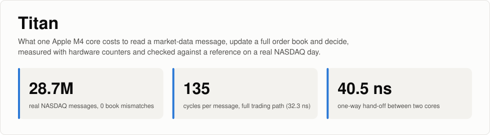
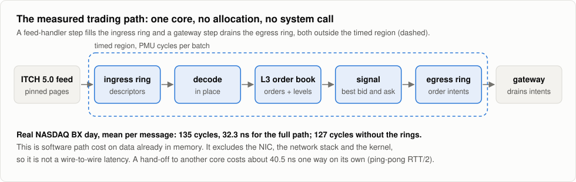
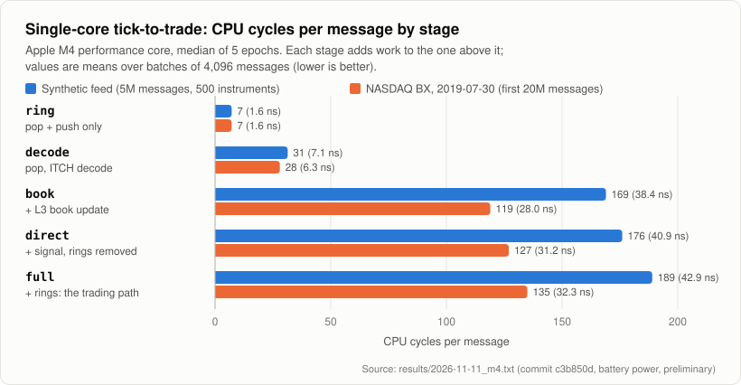
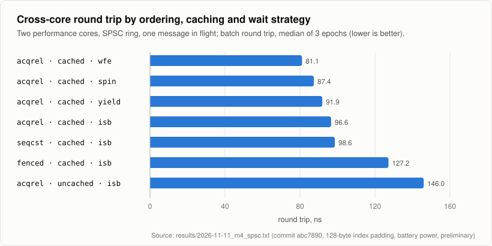
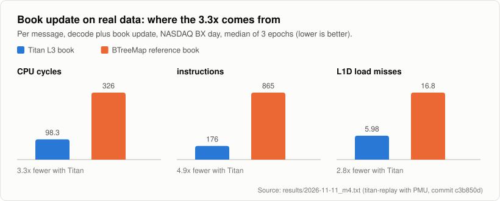
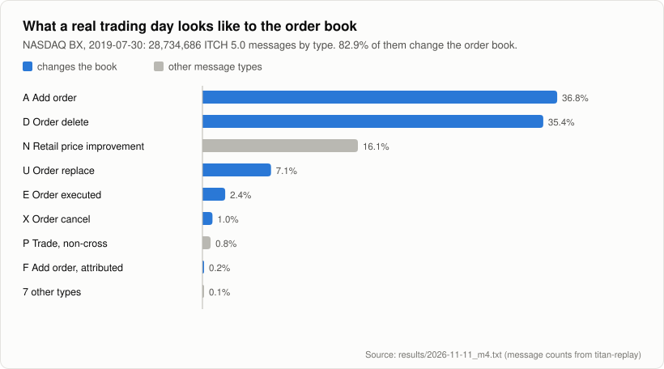
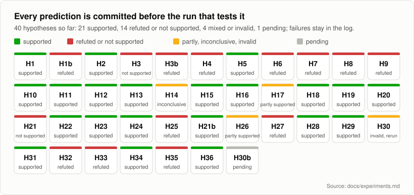

<p align="center">
  
</p>

<p align="center">
  <a href="https://github.com/Nayan991111/titan-hft/actions/workflows/ci.yml"></a>
  
  
  <a href="docs/experiments.md"></a>
  <a href="LICENSE"></a>
</p>

**What does it cost, in CPU cycles, to receive a market-data message, update
a full order book and decide on an order, on one Apple M4 core? And what does
handing that message to another core add?**

Titan answers both questions with hardware performance counters (PMU)
rather than wall-clock timers. Every result is checked by construction: the
order book is verified against an independent reference book after every
message of a real NASDAQ trading day, hot paths are checked to allocate
nothing, and each hypothesis is committed to
[`docs/experiments.md`](docs/experiments.md) before the run that tests it.

<p align="center">
  
</p>

> **Status: preliminary.** Figures below come from runs of 3 to 5 epochs
> inside one process on battery power. The final protocol is at least 30
> independent launches per configuration on wall power; until then, read
> the numbers as estimates with understated uncertainty.

## Results so far

Apple M4 (MacBook Air, Mac16,13), macOS 27.2, Rust 1.92, performance cores.
Cycles are the primary unit because the core clock varies with load (3.3 to
4.4 GHz observed); nanoseconds are given at the clock measured in the same
run.

| Finding | Value | Source |
|---|---|---|
| L3 book agrees with the reference book after every message of a real NASDAQ BX day | 28,734,686 messages, 0 mismatches, 0 unknown order references | [`results/2026-11-11_m4.txt`](results/2026-11-11_m4.txt) |
| Full single-core trading path (ring, decode, book, signal, ring), real BX data | **135 cycles, 32.3 ns per message**, 0 allocations | same |
| Same path, synthetic feed (deeper books, 982k live orders) | 189 cycles, 42.9 ns | same |
| Share of the path spent in the two ring operations | +6.7% cycles (real), +7.8% (synthetic) | same |
| Decode plus book update, real BX data: Titan L3 book vs a `BTreeMap` reference book | 98 vs 326 cycles; 5.98 vs 16.8 L1D load misses per message; 0 vs 301k allocations per pass | same |
| Fastest cross-core round trip (SPSC ring, `wfe` wait) | 81.1 ns; about 40.5 ns one way | [`results/2026-11-11_m4_spsc.txt`](results/2026-11-11_m4_spsc.txt) |
| Rust's default `spin_loop` (`isb`) vs a `wfe` wait | slowest of four waits: 96.6 vs 81.1 ns round trip; 347 vs 272 cycles | same |
| `ldapr` (Acquire, RCpc) vs `ldar` (SeqCst, RCsc) in an SPSC ring | no measurable difference: 8.35 vs 8.34 cycles per streamed message | same |
| Index caching in the ring (each side keeps a private copy of the other's index) | 26x fewer cycles per streamed message (8.35 vs 219) | same |

<p align="center">
  
</p>

<p align="center">
  
</p>

<p align="center">
  
</p>

<p align="center">
  
</p>

The figures are drawn by [`scripts/figures.py`](scripts/figures.py) from the
committed result files; no number in them is typed by hand. They follow the
reader's light or dark theme.

### What these numbers are not

* **Not wire-to-wire latency.** The trading path is timed on data already in
  memory. It excludes the network card, the network stack and the kernel,
  and is not comparable with published wire-to-wire or FPGA figures.
* **Not per-message tail latency.** The arm64 generic counter advances in
  41.67 ns steps and a pair of PMU reads costs about 2,670 cycles, so
  single messages cannot be timed. Values are means over batches of 4,096
  messages; batch percentiles describe batch means.
* **Not a sub-30 ns tick-to-trade claim.** One cross-core hand-off alone
  costs about 40.5 ns on this machine, and the single-core path itself is
  135 cycles.
* **PMU counts include kernel work.** kperf's counting-mode flag did not
  exclude kernel instructions in a `getppid` test (1,110 instructions per
  call in both modes).

## How the measurements are made

| Concern | Approach |
|---|---|
| Timer resolution | `CNTFRQ_EL0` reports 1 GHz but the counter advances in 41 and 42 unit steps (24 MHz grain). It is used for spans only; costs come from PMU cycle counts over batches. |
| PMU access | Apple's private `kperf` and `kperfdata` frameworks, loaded at run time; events resolved by name from the machine's own event database; counter reads serialised with `dmb ish; isb` and bracketing batches, never single events. Validated against a known dependency chain (within 0.04 to 0.46%). |
| Thread placement | macOS has no hard affinity on Apple silicon (`THREAD_AFFINITY_POLICY` returns `KERN_NOT_SUPPORTED`). Threads are steered with QoS classes; involuntary context switches are counted per epoch. |
| Memory | Hot data sits in page-aligned, pre-faulted, `mlock`ed 16 KiB pages. A counting global allocator checks that measured regions allocate nothing. |
| Correctness of what is timed | Differential tests against a reference book after every message; mutation checks (removing backward-shift deletion, off-by-one in wrap-around or binary search, dropping empty levels) make the tests fail; the `full` and `direct` stages must emit identical orders or the run aborts. |
| Bias control | Stage order rotates between epochs; hypotheses are committed before the runs; failed predictions stay in the log with their verdicts. |
| Statistics | Per-epoch medians, bootstrap 95% CI, two-sided Mann-Whitney U (exact when there are no ties), Cliff's delta ([`scripts/analyze.py`](scripts/analyze.py), standard library only). |

<p align="center">
  
</p>

## Components

| Crate or binary | Purpose |
|---|---|
| `titan-platform` | Pinned memory, counter timer and its measured resolution, QoS, kperf PMU sessions, allocation and `getrusage` accounting. Self-test: `titan-probe`. |
| `titan-spsc` | SPSC ring with selectable ordering (`ldapr`, `ldar`, `dmb`), 64 or 128-byte index cells in one 128-byte-aligned block, optional index caching, and four waits (`spin`, `isb`, `yield`, `wfe` on the exclusive monitor). `titan-pingpong` (cross-core round trip) and `titan-stream` (throughput). |
| `titan-itch` | NASDAQ TotalView-ITCH 5.0 decoder (in place, no copies); L3 order book (open-addressed order table with Fibonacci hashing and backward-shift deletion, sorted price levels, fixed-point prices); reference book; synthetic feed generator. `titan-replay` (book replay with full verification) and `titan-t2t` (trading path with stage ablation). |
| `titan-core`, `titan-feed-sim` | The original prototype, kept as a baseline. |
| `scripts/` | Data download, instruction census, statistics, figures. |

## Roadmap

- [x] Platform layer: pinned memory, measured timer resolution, kperf PMU sessions, allocation accounting
- [x] SPSC ring with ordering, padding, caching and wait-strategy ablations; cross-core ping-pong and streaming
- [x] ITCH 5.0 decoder and L3 book, verified message by message on a real NASDAQ day
- [x] Single-core trading path with stage ablation; hostile-input tests; dependency audit in CI
- [ ] Code-placement control (H17): fixed function and loop alignment, then re-test `ldar` against `ldapr`
- [ ] Open-loop cross-core pipeline driven by the real ITCH timestamps, with latency histograms corrected for coordinated omission: per-message tails, not batch means
- [ ] Bursty arrivals (Hawkes process) to load the pipeline beyond the real day
- [ ] Energy and thermal drift per wait strategy on a fanless machine (`powermetrics`, separate runs)
- [ ] Scheduler study: core migrations and preemption tails without thread affinity, over long runs
- [ ] Final protocol: 30 independent launches per configuration on wall power, one reproduction script, archived results
- [ ] Paper

## Reproduce

Requires an Apple silicon Mac and Rust 1.92 or later. PMU runs need root;
quit `powermetrics`, Instruments and Docker first.

```sh
cargo build --release
cargo test --release -- --test-threads=1      # 28 tests, including hostile input
./target/release/titan-probe                  # platform self-test, no root
sudo ./target/release/titan-probe pmu         # also programs and validates the PMU

./target/release/titan-pingpong 200000 3      # round trips per case, epochs
./target/release/titan-stream 10000000 3      # messages per case, epochs
./target/release/titan-t2t messages=5000000 epochs=5
sudo ./target/release/titan-t2t messages=5000000 epochs=5 pmu

scripts/fetch_itch_sample.sh 20190730         # public NASDAQ BX sample day into data/
./target/release/titan-replay file=data/20190730.BX_ITCH_50 epochs=3
./target/release/titan-t2t file=data/20190730.BX_ITCH_50 limit=20000000 epochs=5

python3 scripts/analyze.py output.txt         # statistics over epochs
python3 scripts/figures.py                    # redraw docs/figures from results/
scripts/census.sh --list                      # instructions emitted for each ring variant
```

## Related work

**Memory ordering on Arm and Apple silicon**

* Y. Khayet, A. Morrison. *Arm Weak Memory Consistency on Apple Silicon:
  What Is It Good For?* ASPLOS 2026. Apple M1 and M4, program run time;
  Titan adds inter-core, SPSC and PMU-level measurements.
* L. Wrenger, D. Töllner, D. Lohmann. *Analyzing the memory ordering models
  of the Apple M1.* Journal of Systems Architecture, 2024.
  doi:10.1016/j.sysarc.2024.103102
* L. Wrenger, D. Töllner, D. Lohmann. *TOSTING: Investigating Total Store
  Ordering on ARM.* ARCS 2023. doi:10.1007/978-3-031-42785-5_10
* C. Pulte, S. Flur, W. Deacon, J. French, S. Sarkar, P. Sewell.
  *Simplifying ARM concurrency: multicopy-atomic axiomatic and operational
  models for ARMv8.* POPL 2018. doi:10.1145/3158107
* J. Alglave, L. Maranget, M. Tautschnig. *Herding cats: Modelling,
  simulation, testing, and data mining for weak memory.* ACM TOPLAS 36(2),
  2014. doi:10.1145/2627752

**Inter-core communication and SPSC queues**

* L. Lamport. *Specifying concurrent program modules.* ACM TOPLAS 5(2),
  1983. doi:10.1145/69624.357207 (origin of the classic single-producer,
  single-consumer ring)
* J. Giacomoni, T. Moseley, M. Vachharajani. *FastForward for efficient
  pipeline parallelism: a cache-optimized concurrent lock-free queue.*
  PPoPP 2008. doi:10.1145/1345206.1345215
* M. Torquati. *Single-Producer/Single-Consumer Queues on Shared Cache
  Multi-Core Systems.* arXiv:1012.1824
* T. David, R. Guerraoui, V. Trigonakis. *Everything you always wanted to
  know about synchronization but were afraid to ask.* SOSP 2013.
  doi:10.1145/2517349.2522714 (cache-coherence latency methodology; Titan
  applies the same questions to one Apple M4)
* H. Schweizer, M. Besta, T. Hoefler. *Evaluating the Cost of Atomic
  Operations on Modern Architectures.* PACT 2015. arXiv:2010.09852 (x86;
  Titan measures ordering costs on Arm)

**Measurement methodology**

* T. Mytkowicz, A. Diwan, M. Hauswirth, P. F. Sweeney. *Producing wrong data
  without doing anything obviously wrong!* ASPLOS 2009.
  doi:10.1145/1508244.1508275 (code and environment layout bias; the
  reason for H17)
* C. Curtsinger, E. D. Berger. *STABILIZER: statistically sound performance
  evaluation.* ASPLOS 2013. doi:10.1145/2451116.2451141
* T. Hoefler, R. Belli. *Scientific benchmarking of parallel computing
  systems: twelve ways to tell the masses when reporting performance
  results.* SC 2015. doi:10.1145/2807591.2807644 (reporting rules Titan
  follows: medians with confidence intervals, nonparametric tests)

**Order books**

* M. D. Gould, M. A. Porter, S. Williams, M. McDonald, D. J. Fenn,
  S. D. Howison. *Limit order books.* Quantitative Finance 13(11), 2013.
  doi:10.1080/14697688.2013.803148

## Data, trademarks and licence

Market data is not included in or redistributed by this repository.
`scripts/fetch_itch_sample.sh` downloads a public sample file from Nasdaq's
sample-data site into the git-ignored `data/` folder on the user's machine;
use of that file is subject to Nasdaq's terms. Result files contain only
statistics computed by Titan.

Nasdaq and TotalView-ITCH are trademarks of Nasdaq, Inc. Apple, Apple
silicon and macOS are trademarks of Apple Inc. This project is independent
and is not affiliated with or endorsed by either company.

Code: [MIT](LICENSE), copyright 2026 Nayan Pandit. To cite this work, use
[`CITATION.cff`](CITATION.cff). Security reports: see
[`SECURITY.md`](SECURITY.md).
